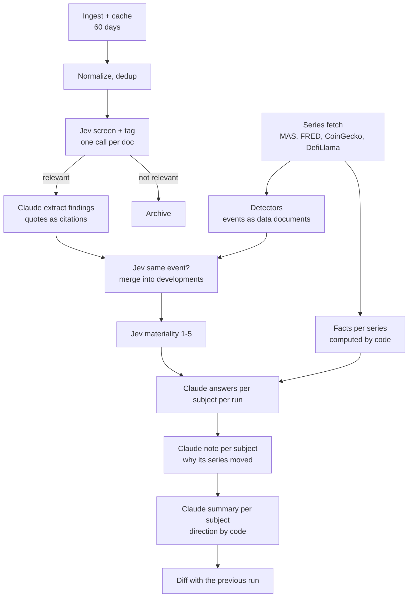

# IntelMonitor POC plan

Sep 24, 2026

This is the build plan for the IntelMonitor proof of concept.
It overrides `spec.md` (the MAS-internal MVP spec) wherever they differ.
UI and UX detail lives in `ui-ux.md`.
The clickable mock is `mocks/new-dashboard.html` ([published](https://claude.ai/artifact/TXoe4Z9QKhtFGBzbEsHCaG)).

## Goal

Show, end to end on one laptop, that pre-answered standing questions over a curated corpus make a useful analyst dashboard.
Jev does the high-volume decisions, Claude writes the findings and answers, and every claim links to its sources.

## How the POC differs from the MVP spec

| Area | MVP spec | POC |
| --- | --- | --- |
| Where it runs | MAS infrastructure | Personal Mac, public data only |
| Ingestion | Scheduled weekly runs over live sources | One data dump covering 60 days and measured series from July 2021, then nine weekly runs computed after the fact |
| DMS | Internal DMS collections | Stand-in collection of public official documents, tagged `source: dms` |
| News | Internal news feeds (Bloomberg and others) | Exa and Tavily, limited to reputable domains |
| Jev | TypeSafe API | Jev through OpenRouter (`jev-1.13`, 32k context) |
| LLM | Internal LLM | Claude through the Claude Agent SDK on the user's Claude login |
| Experiment | Jev hybrid vs LLM-only baseline | Jev hybrid only; every decision is logged so the baseline can be added later |
| Users | Pilot analysts | One hard-coded user |
| Subjects | 3 topics, 5 groups, 10 entities | 3 topics, 5 groups, 22 entities |
| Custom questions | P1 | In scope |

## Scope

**In scope**

- Dashboards: 4-column grid of 8 widget types, edit mode (drag to rearrange, minus to remove), Add widget gallery sheet.
- New dashboard popup with two tabs: Build (gallery sheet layout, mock variant B) and Generate (AG-UI).
- Monitor pages for every topic, group and entity.
- Evidence drawer.
- Graph view (Obsidian-style).
- ⌘K search that jumps to subject pages.
- Built-in standing questions per subject type, plus user-written custom standing questions.
- Mark reviewed and notes.
- Sidebar with New dashboard at the top of the Dashboards list, and a profile menu at the bottom.
- Structured data: MAS statistics APIs (exchange rates; bank asset quality, liquidity and exposure), FRED, CoinGecko and DefiLlama, as measured series.
  They give facts in answers, developments from detectors, an Indicators section and Trend content on monitor pages' Data tab, an Indicator widget, and series on custom questions.
  See `structured-data-plan.md`.

**Out of scope for the POC**

- LLM-only baseline, labelled set and the experiment metrics.
- Event scope, jurisdiction filter UI, personal watchlists as a separate object.
- The "ask" half of ⌘K (question answering from the search box).
- Real-time or intraday market data.
- Analysis card display and exposure map widget.
- Dark mode, phone layout, multiple users, scheduled runs.

## Subjects

Every entity sits in at least one group, and every group links to at least one topic.

**Topics**

| Topic | Covers |
| --- | --- |
| Banking regulation | Basel III implementation, capital and liquidity, AML/CFT, operational and technology resilience, supervisory enforcement |
| Geopolitics | US-China relations, tariffs, sanctions and export controls, South China Sea, regional security events with financial effects |
| Stablecoins | Stablecoin regulation and licensing, reserves and pegs, issuer activity, bank involvement, tokenised deposits |

**Groups and entities**

| Group | Members | Linked topics |
| --- | --- | --- |
| Singapore banks | DBS, OCBC, UOB | Banking regulation, Stablecoins, Geopolitics |
| SEA regional banks | Maybank, CIMB, Bangkok Bank | Banking regulation, Geopolitics |
| Central banks | MAS, Fed, ECB, PBoC, HKMA, BNM | Banking regulation, Stablecoins |
| Stablecoin issuers | Circle, Tether, Paxos, StraitsX | Stablecoins |
| SEA countries | Singapore, Malaysia, Indonesia, Thailand, Vietnam, Philippines | Geopolitics |

Subjects and links are seeded from one checked-in file, `api/seed/subjects.yaml`, with aliases for entity resolution (for example "Oversea-Chinese Banking Corporation" for OCBC, "Bank Negara" for BNM, "XSGD" for StraitsX).

## Standing questions

Each question has an id, a short label (shown in widgets), full wording, a lookback, and the subject types it applies to.
All wording lives in `api/seed/questions.yaml`.

### Topic questions (all topics)

| Label | Question |
| --- | --- |
| New developments | What material developments happened on this topic? |
| Direction | Is the picture getting more or less severe than at the last run? |
| Who's moving | Which jurisdictions or bodies took action, and are they converging or splitting? |
| Upcoming | What deadlines, effective dates, meetings or consultation closes fall in the next 90 days? |
| Impact | Which tracked groups and entities are affected, and how? |
| Local relevance | What does this mean for Singapore and MAS-supervised institutions? |

### Topic-specific questions

| Topic | Label | Question |
| --- | --- | --- |
| Banking regulation | Stage | Is each item a signal, consultation, proposal, enacted rule or enforcement? |
| Banking regulation | Enforcement | Were any enforcement actions or penalties announced against banks? |
| Geopolitics | Escalation | Which flashpoints are escalating, and which are cooling? |
| Geopolitics | Sanctions and trade | Were new sanctions, tariffs or export controls announced that touch tracked entities or countries? |
| Geopolitics | Financial channels | Are there effects on capital flows, FX, payments or trade finance? |
| Stablecoins | Stage | Where is stablecoin regulation in each jurisdiction: signal, consultation, proposed, enacted or enforced? |
| Stablecoins | Reserves and peg | Were there depegs, reserve concerns or attestation findings? |
| Stablecoins | Bank involvement | Are banks issuing, custodying, settling or partnering on stablecoins or tokenised deposits? |

### Group questions (all groups)

| Label | Question |
| --- | --- |
| Common issues | Is the same issue showing up at several members? |
| Exposure | Which members are most and least exposed to new developments? |
| Outliers | Is any member behaving differently from its peers? |
| Topics | Which tracked topics are affecting this group most right now? |
| Peer moves | Did any member make a move its peers are likely to follow? |
| Contagion | Could an issue at one member spread to others? |

### Entity questions by type

**Banks** (DBS, OCBC, UOB, Maybank, CIMB, Bangkok Bank)

| Label | Question |
| --- | --- |
| Incidents | Have any material operational or technology incidents occurred? |
| Adverse | Is there anything that could hurt this bank? |
| Regulatory | Any regulatory actions, findings or new obligations? |
| Financial | Any material changes in earnings, capital, liquidity or asset quality? |
| Management | Any senior management or board changes? |
| Strategy | Any significant M&A, product or technology moves? |
| Digital assets | Any stablecoin, tokenisation or crypto activity or exposure? |
| Geographic exposure | Is the bank exposed to any escalating geopolitical situation? |

**Central banks** (MAS, Fed, ECB, PBoC, HKMA, BNM)

| Label | Question |
| --- | --- |
| Policy stance | Did the policy stance on rates, liquidity or FX change? |
| Regulation | Any new rules, consultations or guidance for banks? |
| Enforcement | Any supervisory or enforcement actions? |
| Digital money | Any moves on CBDCs, stablecoins or tokenisation? |
| Signals | What did leadership signal in speeches or statements? |
| Cross-border | Any new cooperation agreements or joint statements? |

**Stablecoin issuers** (Circle, Tether, Paxos, StraitsX)

| Label | Question |
| --- | --- |
| Reserves | What do the latest attestations or disclosures say about reserves? |
| Peg | Has the peg held, and were there redemption pressures? |
| Licensing | Did the issuer gain, lose or apply for any licence? |
| Banking partners | Any changes to banking, custody or settlement partners? |
| Incidents | Any hacks, freezes, outages or legal actions? |
| Strategy | Any new chains, markets, products or partnerships? |

**Countries** (Singapore, Malaysia, Indonesia, Thailand, Vietnam, Philippines)

| Label | Question |
| --- | --- |
| Political stability | Any political events that change policy direction or stability? |
| Economic policy | Any material fiscal, monetary or FX policy moves? |
| Trade and sanctions | Is the country affected by new tariffs, sanctions or export controls? |
| Security | Any security or territorial incidents with financial implications? |
| Financial sector | Any stress or major regulatory change in the banking system? |
| Digital assets | Any change in stablecoin or crypto policy? |

### Custom standing questions

- The user writes a question on any monitor page ("Add a question"), or picks "Custom question" in the widget gallery.
- Claude turns it into a config: tidied wording, a short label, the subject it applies to, and a lookback (default 14 days).
- The user sees the config and a preview answer, then **Keep** or **Discard**.
- The answer job runs on demand over the stored corpus (see Pipeline, step 8) for both run dates, so the change badge works from day one.
- Custom questions show a "Custom" label, can be edited or deleted, and are capped at 10.

## Data sources

All sources cover the 60 days ending on the ingestion date (`T0`).

| Source | What | How | Key |
| --- | --- | --- | --- |
| MAS | Media releases, speeches, consultations, notices, circulars, enforcement actions | Public search API `mas.gov.sg/api/v1/search`, filtered by content type and date | None |
| Fed | Press releases, speeches | RSS | None |
| ECB | Press releases, publications | RSS | None |
| HKMA | Press releases | Open API `api.hkma.gov.hk/public/press-releases` | None |
| BIS | Central bankers' speeches (covers BNM, PBoC, BI, BOT and others), press releases | RSS | None |
| FSB | Publications | RSS | None |
| News | Reuters, FT, Bloomberg, CNBC, Nikkei Asia, Straits Times, Business Times, CoinDesk, The Block and similar | Exa search with `includeDomains` and date range, one query set per subject | `EXA_API_KEY` |
| Gaps | Subjects with thin coverage (for example BNM, PBoC, Bangkok Bank) | Tavily search, and Exa limited to the subject's own domain | `TAVILY_API_KEY` |

**Stand-in DMS.** MAS consultations, notices, circulars and enforcement actions, plus BIS and FSB papers, form the `dms` collection.
They carry `classification: public` so the classification-based engine routing from the spec is in place.

**Budget rules.**

- Every external response is cached to `data/raw/` keyed by request, and a rerun never calls a source twice.
- Target 300 to 600 documents after dedup.
- Search queries are generated from `subjects.yaml` (name, aliases, topic keywords), not written by hand per subject.

**MAS statistics APIs.** Subscribed and tested; in scope as indicator series (see `structured-data-plan.md`).
Base URL is `MAS_API_BASE_URL` (`https://eservices.mas.gov.sg/apimg-gw`); each key goes in a `keyid` header.
Paths are fixed per API and belong in code, not `.env`.
All figures are system-wide aggregates for commercial banks in Singapore, not per bank.

| Key variable | Table | Frequency | Path after the base URL |
| --- | --- | --- | --- |
| `MAS_EXCHANGE_RATES_API_KEY` | Exchange Rates, End of Period, Daily | Daily | `/server/monthly_statistical_bulletin_non610ora/exchange_rates_end_of_period_daily/views/exchange_rates_end_of_period_daily` |
| `MAS_BANK_ASSET_QUALITY_API_KEY` | I.12A Commercial Banks, Non-Performing Loans by Sector | Quarterly | `/server/monthly_statistical_bulletin/table_i_12a_commercial_banks_non_performing_loans_by_sector_npl/views/table_i_12a_commercial_banks_non_performing_loans_by_sector_npl` |
| `MAS_BANK_LIQUIDITY_API_KEY` | I.18 Commercial Banks, Non-Bank Loan to Deposit Ratios | Monthly | `/server/monthly_statistical_bulletin/table_i_18_commercial_banks_non_bank_loan_to_deposit_ratios_ltd/views/table_i_18_commercial_banks_non_bank_loan_to_deposit_ratios_ltd` |
| `MAS_BANK_EXPOSURE_API_KEY` | I.5B Commercial Banks, Loans and Advances to Non-Residents by Industry | Monthly | `/server/monthly_statistical_bulletin/table_i_5b_commercial_banks_loans_and_advances_to_non_residents_by_industry/views/table_i_5b_commercial_banks_loans_and_advances_to_non_residents_by_industry` |
| `MAS_SORA_KEY` | Domestic Interest Rates, Daily (SORA, compounded SORA) | Daily | `/server/monthly_statistical_bulletin_non610mssql/domestic_interest_rates_daily/views/domestic_interest_rates_daily` |

Results come back oldest first, so recent data needs `$orderby` (for example `year DESC,month DESC`) with `$count`.
The exchange rate API requires at least one filter, such as `end_of_day=YYYY-MM-DD`.

**Other series sources.** FRED (`FRED_API_KEY`) gives the Fed funds rate, the ECB deposit rate, the US 10-year yield, the US high-yield spread and the VIX.
CoinGecko (`COINGECKO_API_KEY`, demo tier) gives daily stablecoin prices for the last 365 days.
DefiLlama needs no key and gives stablecoin supply, per coin and per chain.
`api/seed/series.yaml` declares the 62 series and maps each to its subjects.
Series responses go to the same `data/raw/` cache.
A series request is keyed by its fetch day (FRED by the UTC hour), so a new day makes new requests and a past day's responses stay cached.

**Parsing.** HTML goes through a readability extractor, PDFs through pymupdf.
Documents are deduplicated by canonical URL and content hash.

## Pipeline

A run is computed "as of" a date and only sees documents published on or before it, and observations that were available by the end of it.
The POC computes weekly runs on Thursdays, from 30 Jul to `T0` (24 Sep); each compares with the one before.
The last two are **Run 1** as of `T0 - 7 days` and **Run 2** as of `T0`.
"Since your last review" is Run 2 compared with Run 1.



1. **Ingest.** Fetch, cache, parse, dedup. Store `SourceDocument` rows with source, collection, URL, title, published date, text, hash and classification.
2. **Jev screen and tag.** One System One call per document, using fan-out:
   - relevance (noul),
   - one noul per subject (30 subjects),
   - category (choice: incident, regulatory, financial, management, strategy, policy, security, market, other),
   - jurisdictions (one noul per jurisdiction in a fixed list),
   - stage (choice, only used for regulatory items),
   - adverse (noul),
   - direction for the most likely subject (choice: positive, negative, neutral).

   Documents longer than the state budget (about 24k tokens) are screened on their title plus leading chunks.
3. **Confidence routing.** Clear yes and clear no are used directly.
   The uncertain middle band on relevance and subject tags goes to Claude.
   Thresholds live in one config file and start at 0.3 and 0.7.
4. **Claude extract.** For each relevant document, Claude returns findings as JSON: statement, subjects, category, event date, dates mentioned (for Upcoming), and one or more verbatim quotes.
   Code checks every quote appears in the document text and drops findings whose quotes don't match.
5. **Same event.** Candidate pairs come from findings that share a subject, fall within 10 days of each other, and are similar by local embeddings (fastembed).
   Jev decides each pair (noul), and code merges matches into one `Development` with all its sources.
6. **Materiality.** Jev scores each development on five levels (Trivial, Minor, Notable, Significant, Critical). Score levels are sent as an array and come back indexed 0 to 4, so a score of 3 or more means "Needs attention".
7. **Answers.** One Claude call per subject per run answers all of that subject's questions from the developments tagged to it inside each question's lookback.
   Each answer has a one-line summary, a state (Stable, Watch, Needs attention, or a count of new items), and the development ids it relies on.
8. **Custom question job.** For a new custom question, Jev scores each candidate document tagged to the subject within the lookback ("Does this document help answer: ...?"), and Claude answers from the top matches for both run dates.
9. **Diff.** Code compares each run with the one before: new developments, updated developments (new sources), and changed question states.
10. **Graph.** Nodes and edges are written from subjects, links and developments (`MEMBER_OF`, `EXPOSED_TO`, `AFFECTS`), each edge with source and confidence. Jev tags each development with one of six themes, which the graph view colours and groups by.

**Measured series.** `im ingest` and Run now fetch the series before anything else (`structured-data-plan.md`, F1).
A run then adds four steps:

- **Detectors** (F3) turn series events, such as a policy rate change or a stablecoin off its peg, into data documents with one finding each.
  They join developments through the same-event step, set the development's title to their measured sentence, and set its materiality to at least the detector's level.
- **Indicators** (F1) store every series' latest value, changes and state as of the run.
- **Facts** (F2) give each answer the sentences code computed for its linked series.
  An answer may quote a number only from its facts or documents and names FX moves by the SGD's side, or it is asked again once.
  Rules such as "0.5% off the peg for 24 hours" fix a state whatever the model says.
- **Notes** (F6): one Claude call per subject with series writes why they moved in the week, citing the week's developments.

**Summaries.** After the notes, one Claude call per subject writes the paragraph at the top of its monitor page (`pipeline/summaries.py`), on `claude-sonnet-5-5` while every other step keeps the configured model.
It reads only the run's stored rows: the focus area answers with their previous states, the subject's new or updated developments that need attention or are adverse, the detector events on its series, and its Trend note's headline.
The paragraph has at most 60 words, no dashes, and only numbers its inputs give, or it is asked again once.
Code sets the direction: the run is more adverse, less adverse or unchanged against the previous run on a score of 2 per focus area at Needs attention, 1 per focus area at Watch and 1 per adverse development needing attention, so a focus area moving between Watch and Needs attention moves it.
`run_summaries` keeps the text, the direction and its basis in words, and the counts of the subject's developments, those needing attention and those adverse, as its Developments tab lists them.
`im summarize` rewrites summaries of complete runs without recomputing anything else.

A backfilled run never sees the future: observations carry `available_at`, and a run as of D reads each one only if it was known by the end of D, at its value before any later revision.

**Logging.** Every Jev and Claude call writes an `InferenceRecord`: stage, model and version, input reference, output, confidence, tokens or cost, run id.

**Claude calls.** All Claude work goes through the Claude Agent SDK (Python) with structured JSON output, using the user's Claude login (`ANTHROPIC_API_KEY` stays empty).
Concurrency is capped (start at 4) to stay within the subscription allowance.
The pipeline is resumable: each step skips work whose output already exists.

## Architecture

```
api/                Python 3.12, uv
  intelmonitor/
    ingest/         source adapters, series adapters (ingest/series/), cache, parsing
    pipeline/       jev, claude, dedup, detectors, facts, answers, notes, diff, graph
    store/          SQLite schema and queries
    server/         FastAPI app, AG-UI endpoint
    agent/          Generate agent: Claude Agent SDK + dashboard tools
  seed/             subjects.yaml, questions.yaml, series.yaml, detectors.yaml, dashboards.yaml
web/                Vite, React, TanStack Router (routes/) and Query, TypeScript, pnpm
data/               gitignored: raw cache, intelmonitor.db
artifacts/          gitignored: E2E runs and pipeline reports
mocks/              design mocks
```

- **Store:** one SQLite file. Tables: subjects, subject_links, standing_questions, source_documents, document_tags, runs, findings, developments, development_subjects, development_sources, question_answers, upcoming_dates, analyst_actions, dashboards, graph_nodes, graph_edges, inference_records.
  Series add series, series_subjects, observations, observation_revisions, detections, and per run run_indicators, run_facts, run_notes and run_summaries.
- **API:** FastAPI. Pydantic models are the source of truth, and `openapi-typescript` generates the web client types from the OpenAPI schema, so the two sides can't drift.
- **Dashboard spec:** a list of widgets with `type`, `size`, `order` and typed `settings` (subject, question). One schema per widget type drives the gallery, manual edits and the Generate agent.
- **Generate agent:** Claude Agent SDK with in-process tools `add_widget`, `update_widget`, `remove_widget`, `reorder` and `list_subjects`. Tool arguments are validated against the widget schemas. The server maps the agent's stream to AG-UI events (`TEXT_MESSAGE_*`, `TOOL_CALL_*`, `STATE_DELTA`, and a `CUSTOM` "changes" event naming the message that lists the run's changes) over SSE. A prompt whose request fails before the agent starts (a dropped connection, Chrome's network-change abort, a 502 to 504 while the API restarts) is sent again after 1, 2 and 4 seconds; once the agent has written or edited anything it is not.
- **Web AG-UI client:** bare `@ag-ui/core` and `@ag-ui/client`, no CopilotKit. One hook applies state deltas to the dashboard spec and tracks pending changes for Keep and Undo.
- **Graph view:** sigma.js with graphology, laid out by a d3-force simulation that pulls each development toward its theme's sector. Jev tags each development with one theme in the graph step. The simulation runs until it cools and then stops; dragging a node reheats it until it cools again.
- **Dev servers:** `portless intelmonitor.web pnpm dev` and `portless intelmonitor.api uv run ...`, served at `https://intelmonitor.web.localhost` and `https://intelmonitor.api.localhost`. Run `scripts/proxy-start.sh` first so the Portless proxy listens on 443 without sudo.

**Commands**

- `uv run im ingest` fetches the series, then fetches and parses the corpus.
- `uv run im series fetch` fetches every series up to today; `uv run im series backfill --from 2021-07-01` fills their history once.
- `uv run im run --as-of <date>` computes one run. `uv run im run --both` computes Run 1 and Run 2.
- `uv run im summarize --as-of <date>` or `--all` rewrites the subject summaries of complete runs; `--subject <id>` limits it to some subjects.
- `uv run im report` writes the pipeline report (see Verification).
- `uv run im check series`, `im check past-run` and `im check depeg` print the JSON checks the E2E walkthrough runs in scratch stores (see Verification).

## UI

The UI follows `ui-ux.md` and the mock.
The app only shows data from the API; there is no sample data in the web code.

- **Sidebar:** Dashboards (New dashboard first, then the user's dashboards), Monitors (Topics, Groups, Entities with counts), profile button at the bottom.
- **Top bar:** the search field, then a run status chip (last run time, Runs popover with run history and Run now) and an alerts bell (unread count, Alerts popover of Needs attention and Watch developments). Run now fetches the series, then computes Run 2 again over the stored corpus; document ingestion stays offline in the POC.
- **Profile menu:** Settings (display name, default dashboard), Data sources (sources and document counts), Run history (runs with dates, document counts and duration), Help (glossary, shortcuts and Replay tour; see `iteration-plan.md` B2).
- **Starter dashboards:** three seeded dashboards (Singapore banks, Stablecoin watch, Geopolitics in SEA) so the first screen is never blank.
- **Widgets (8):** Since your last review, Standing question, Monitor summary, Developments, Direction of travel, Watchlist, Upcoming, Indicator.
  Direction of travel counts material developments per week from Jev tags. Upcoming reads dates extracted in pipeline step 4.
  Indicator shows one series' state and value, its 12-month line at M, and its marked developments at L.
- **New dashboard popup:** 80% of the screen, Build selected by default.
  Build uses the gallery sheet layout (mock variant B). Generate starts with a centered input that slides to the bottom as widgets arrive.
- **Monitor pages:** a head with Mark reviewed and Follow over four tabs.
  Overview: the run's summary, focus areas (built-in and custom, plus "Add a focus area"), Key data, Needs attention, a small Connections graph and notes.
  Developments: What changed with triage, then the subject's or its peers' developments.
  Data, for subjects with series: Indicators, then each run's note on why the series moved, the series over 12 months with developments marked, and question states per run.
  Connections, for groups and entities: the graph, a peers table or common issues and outliers, and related subjects.
- **Evidence drawer, graph view, ⌘K search:** as in `ui-ux.md`. The drawer lists cited series and detections as data sources, each with its chart.

## Phases

Each phase ends with its checks passing.
Commit at the end of each phase.

| Phase | Output | Done when |
| --- | --- | --- |
| 0. Setup | Repo layout, `.env` loading, uv and pnpm projects, Portless | One Jev call through OpenRouter and one Claude Agent SDK call both return structured answers from a smoke script |
| 1. Ingest | Source adapters, cache, parser, dedup | 300 to 600 documents in the store across all sources; every subject has at least 5 candidate documents; a second `im ingest` makes zero external requests |
| 2. Pipeline | Steps 2 to 7, 9 and 10 for both runs | Every subject has an answer for every question in both runs; every finding has at least one verified quote; inference records exist for every call; `im report` is written |
| 3. API | Endpoints for subjects, pages, widgets, developments, evidence, graph, search, dashboards, actions, custom questions | Generated TS types compile in `web`; every endpoint returns data for a sample of subjects |
| 4. App shell and widgets | Sidebar, profile menu, dashboards, 7 widgets, edit mode, Add widget sheet | Starter dashboards render real data; drag and minus persist after reload |
| 5. Monitor pages and evidence | Topic, group and entity pages, evidence drawer, ⌘K search | Every subject page renders; every "See evidence" opens sources with highlighted quotes |
| 6. New dashboard | Build (variant B) and Generate over AG-UI | Both tabs create a dashboard that appears in the sidebar; Generate shows outlines, Keep and Undo; follow-up requests edit the same dashboard |
| 7. Graph view | Obsidian-style graph from any monitor page | Opens at 1 hop, expands to 2, filters work, new developments highlighted, developments grouped by theme, nodes drag without opening, clicking a node opens its page, layout stops when settled |
| 8. Custom questions | Add, preview, keep, edit, delete | A custom question shows an answer with citations for both runs and a change badge |
| 9. E2E | Full walkthrough test | The E2E run passes and writes its artifact (see Verification) |
| 10. Structured data | F1 to F7 of `structured-data-plan.md`: series store, facts, detectors, Indicators, Indicator widget, data sources in the drawer, Data tab, custom questions with series | The E2E walkthrough's structured data steps pass |

## Verification

**Pipeline report.** `uv run im report` writes `artifacts/pipeline/<timestamp>/report.md` with:

- documents per source and per subject,
- relevance rate, and the share of decisions Jev made directly versus routed to Claude,
- developments per subject and the merge ratio (sources per development),
- materiality distribution,
- 10 random findings with their quotes and source links for a manual spot check,
- Jev and Claude token totals and cost,
- series: the latest fetch (rows added and revised, failures, stale series, calls per source) and, per run, indicator states, facts, answers citing series, states fixed by rules and detections, each with a look-ahead check.

**E2E.** One Playwright test in `web/e2e/` runs against the dev servers and records video, a trace and a screenshot per step into `artifacts/e2e/<timestamp>/`, with an `index.html` summary.
It covers:

1. Open the Singapore banks dashboard and check "Since your last review" shows Run 2 changes.
2. Open evidence on a development and check the quote is highlighted in the source.
3. Edit mode: drag a widget, remove one, reload, check the layout persisted.
4. New dashboard, Build: pick a subject, add three widgets, rearrange, create, check it appears in the sidebar.
5. New dashboard, Generate: send a prompt whose first request is dropped, check it is sent again and widgets arrive with a summary counting them, Undo, send again, Keep, create.
6. Open a monitor page from ⌘K, add a note, delete it and Undo (the Undo toast waits while hovered and otherwise lasts 8 s), then mark reviewed and Undo on the Developments tab.
7. Add a custom question, keep it, check the answer and citations.
8. Open the Connections tab, then the full graph view, expand to 2 hops, click a node, check its page opens.
9. Drag a sidebar dashboard to the top, move another with Move up, reload, check the order persisted and colors did not change.

For structured data (`structured-data-plan.md`), it also covers:

10. Series: quotes per 100 units are stored per unit (SGD per MYR on 18 Sep is 0.3128), and indicators as of Run 1 see nothing published later.
11. A series backfill and the daily fetch after it, replayed from cached responses into a scratch store (`im check series`): no request reaches a source, the fetch adds and revises nothing, and the values match the store.
12. A past-date run: Run 1, recomputed in a copy of the store from recorded model calls only (`im check past-run`), uses nothing known after its date, not even the Fed funds detection known a day later, and matches the stored run.
13. Facts in answers: answers cite their series' facts, and facts as of a past date state nothing known later.
14. A detector firing: the Fed funds rise of 17 Sep becomes a Run 2 development titled by its measured sentence, alerts for a followed subject, and opens in the evidence drawer with the data source first.
15. Fixture prices (`im check depeg`): 48 hours off the peg fixes the Peg answer at Needs attention and makes the detection a Significant development.
16. The Indicators section on a bank page and the Fed's page.
17. The Indicator widget: set by subject, then added from the gallery at Large with developments on its lane.
18. The drawer's data source item: the sentence, flags in words and the chart with the cited period.
19. The Data tab: each run's note with numbered citations on the chart, question states per run, and no note before the first document.
20. A custom question with a series: the picker, answers citing its facts, and the widget's line at M.

Each structured data step also writes its data as JSON next to the screenshots (for example `series-fetch.json`, `past-run.json`, `trend.json`), so a run can be compared with the next.

## Risks

| Risk | Mitigation |
| --- | --- |
| Free-tier search budgets run out | Cache everything, generate queries from the seed file, cap results per query |
| Paywalled news returns partial text | Prefer primary sources for facts; keep partial articles as supporting sources only |
| Claude subscription rate limits during precompute | Capped concurrency, resumable steps, one answer call per subject per run |
| Jev's 32k context on OpenRouter | Screen long documents on title and leading chunks; Claude reads the full text for extraction |
| MAS search API is undocumented | Treat as best effort; fall back to Exa limited to `mas.gov.sg` |
| A series source changes shape, rejects a key or answers with an HTML page | Pydantic models per response; the failure stays with that source's series, is logged once and never cached; `im check series` replays the fetch offline |
| Entity resolution errors (for example "Singapore" the country vs Singapore banks) | Aliases in the seed file, Jev subject nouls, and the pipeline report spot check |
