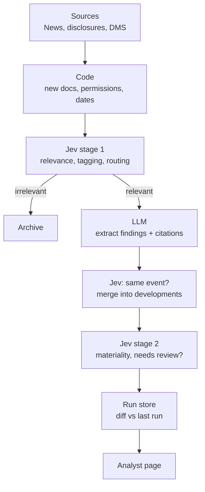

# IntelMonitor — MVP Spec v3

Sep 23, 2026 · wongkang

## Goal

IntelMonitor answers **"What changed in what I track since I last looked?"** without the analyst writing a prompt.

It runs a fixed set of standing questions against internal and external sources on a schedule, keeps every run, and shows what changed with links to the evidence.

The internship tests two things:

1. **Product:** Do pre-answered standing questions save analysts time versus searching `@askDMS` / `@askNews` themselves?
2. **Architecture:** Can Jev (a typed decision model) handle the high-volume screening and routing, so the LLM only sees what matters?

Why this problem: earlier research found users often don't know what to type, and analysts ask the same questions about the same banks every week.

## MVP scope

One connected slice, end to end: **3 topics, 5 groups, 10 entities, News + DMS, one weekly run, a page per scope that shows what changed.** The specific subjects are picked with pilot users in phase 1, not fixed now.

One rule keeps drill up and down working: every entity sits in at least one group, and every group links to at least one topic.

| In the MVP | Later (P1) |
| --- | --- |
| 3 topics | More topics and topic subtypes (technology, geopolitical, macro) |
| 5 groups (static lists) | More groups; groups defined by topic exposure |
| 10 entities | More entities |
| — | Event scope (time-bound) |
| Light relationship scope: hand-curated dependencies + LLM-suggested links | Full relationship scope with dependency data from MAS datasets |
| Mini knowledge graph + links section + graph view on every page | Merge into the enterprise knowledge graph |
| Jurisdiction tag stored on every development | Jurisdiction filter on every page |
| — | Personal watchlists |
| Standing questions at all three scopes | Per-user question selection |
| News + public disclosures + DMS | FI submissions, structured datasets |
| Scheduled weekly run, every run stored | Daily runs, per-source refresh |
| Jev for relevance, tagging, routing, dedup, materiality | Jev for more decision types |
| LLM for findings and summaries, with citations | Daily multi-subject brief |
| Run-to-run diff ("since last review") | Multi-month trend charts |
| Drill up and down between scopes | Custom user-built groups |
| Mark reviewed, add note | Flags, assignment, alerts |
| — | MCP server for Claude/ChatGPT |

## Three monitoring scopes

**The user picks how wide to look. The pipeline is the same at every scope.**

| Scope | Example | Core question | Page shows |
| --- | --- | --- | --- |
| Topic (wide) | AI safety regulation | What's happening, and where is it heading? | Developments, stage, direction, which groups are hit |
| Group / sector (medium) | Singapore banks | What's affecting this sector, and who's most exposed? | Common issues, outliers, topics hitting the sector |
| Entity (narrow) | OCBC | What changed for this entity? | Its developments + topics affecting it |

How it stays one system:

- Each development is stored once and tagged with the topics, groups and entities it touches. Jev does the tagging.
- A scope is a filter plus a question set. All pages read from the same store.
- Users move between scopes: from OCBC up to Singapore banks, or out to AI safety regulation.
- Onboarding is one line: "Monitor AI safety regulation", "Monitor SG banks" or "Monitor OCBC".

### More scopes

Two more scopes use the same pipeline. Relationships ship in the MVP in a light form, built on the mini knowledge graph. Events come in P1.

| Scope | Example | Core question | How it differs |
| --- | --- | --- | --- |
| Event (time-bound) | Major cloud outage; bank run abroad | Who is affected, is it spreading, is it over? | Has a start and end date; opened by an analyst, closed when resolved |
| Relationships | OCBC + its cloud providers, subsidiaries, key counterparties | Did something happen to someone this entity depends on? | Follows `SubjectLink` dependencies; surfaces third-party and concentration risk |

Event standing questions:

- Which tracked entities and groups are affected so far?
- Is the impact spreading to new entities or jurisdictions?
- Has anyone confirmed or denied impact (statements, FI submissions)?
- Is the event resolved, or still developing?

Relationship standing questions:

- Has anything material happened to a provider, subsidiary or counterparty of this entity?
- Do several tracked entities depend on the same affected provider? (concentration)
- Has a dependency changed (new provider, exit, ownership change)?

### Filters and views

These are not scopes. They sit on top of every scope.

- **Jurisdiction filter.** Each development gets a jurisdiction tag (Jev Choice). Any page can be filtered: "AI safety regulation, EU only" or "SG banks, overseas operations."
- **Personal watchlist.** A saved mix of subjects, like "my 5 banks + 2 topics." It is a view over existing subjects, not a new level.
- **Topic subtypes.** Technology, geopolitical and macro topics are topics with their own question sets, not new scopes. Example: geopolitics asks "Which jurisdictions are escalating?"; macro asks "Which indicators crossed a threshold?"

Not planned: tracking named individuals directly. Management changes are covered at entity level, and people tracking raises privacy questions.

## How it works

Each run: code filters, Jev screens and routes, the LLM writes findings, Jev decides what to surface.



The run reads from the already-indexed store. It does not re-download everything each time.

## Jev: the decision layer

**Jev is the default engine for every bounded decision in the pipeline.** It takes context plus a fixed question and returns a typed answer with a probability. That matches most of IntelMonitor's high-volume work.

| Decision | Jev output | What code does with it |
| --- | --- | --- |
| Is this doc relevant to any tracked subject? | Probability | Below threshold → archive |
| Which topics, groups and entities does it touch? | Probability per subject | Tags the development so every scope can see it |
| Which jurisdiction? | Choice (multi-label) | Powers the jurisdiction filter |
| Which standing questions does it touch? | Probability per question | Only send to questions above threshold |
| Which category? | Choice (incident, regulatory, financial, management, strategy, other) | Tag the finding |
| What stage is it? (regulatory topics) | Choice (signal, consultation, proposed, enacted, enforced) | Sorts proposals from rules; drives the stage trend |
| Positive or negative for this entity/group? | Choice | Impact direction on group and entity pages |
| Is it adverse? | Probability | Feeds materiality and page ordering |
| Same event as an existing development? | Probability | Merge, so 12 articles = 1 development |
| How material? | Ordered score 1–5 | 4–5 → "needs attention" |
| Does it affect a dependency of a tracked entity? (P1) | Probability | Relationship scope alerts |

**Routing by confidence.** Clear yes and clear no are handled directly. The uncertain middle band goes to the LLM. Thresholds are tuned per decision on the labelled set; adverse screening gets a lower cut-off to protect recall.

**Interface.** All decisions go through one `DecisionEngine` class. Jev is the main implementation. An `LLMDecisionEngine` exists as the baseline for the experiment — it is the comparison, not a fallback plan.

**Logging.** Every call writes an `InferenceRecord` (stage, model, version, input ref, output, confidence, run id). This is what makes the experiment measurable.

## What the LLM does

The LLM only handles work that needs prose or open-ended reasoning:

- Extract findings from relevant docs, with citations
- Write the one-paragraph answer per standing question
- Explain what changed and why it matters
- Resolve conflicting sources
- Decide the uncertain middle band Jev passes up

Dates, counts, diffs between runs and permissions are plain code, not AI.

## Core objects

Eight objects. A document is evidence, not an alert.

| Object | What it is | Example |
| --- | --- | --- |
| `MonitoringSubject` | The thing being watched; `type` = topic, group, entity (event in P1) | AI safety regulation / SG banks / OCBC |
| `SubjectLink` | How subjects relate | OCBC member of SG banks; SG banks exposed to AI safety regulation; OCBC depends on a cloud provider (P1) |
| `StandingQuestion` | A recurring question for one scope, with lookback and sources | "Is the same issue showing up at several members?" (group, 7 days) |
| `MonitoringRun` | One execution for one subject; always kept | OCBC, 23 Sep 06:00, 142 docs retrieved, 17 relevant |
| `SourceDocument` | One piece of evidence | A news article or DMS file, with hash and permissions |
| `Finding` | An answer to one question in one run | "New CFO announced" — 3 sources |
| `Development` | One real-world event, stored once, tagged with every subject it touches | Draft AI rules for banks → tagged: topic, SG banks, DBS, OCBC, UOB |
| `AnalystAction` | Reviewed / note, with user, time, run id | "Checked SG impact — none." |

Each run stores the question version and model versions used, so a past page can be reconstructed.

## Mini knowledge graph

**IntelMonitor ships a small graph of its own subjects and developments.** It powers a light relationship scope and a navigational graph view. It is also a deliberate pilot for the enterprise knowledge graph project.

| Nodes | Edges | Where edges come from |
| --- | --- | --- |
| Topics, groups, entities (events in P1) | `MEMBER_OF`, `EXPOSED_TO`, `DEPENDS_ON` | Hand-curated |
| Developments | `AFFECTS` (development → subject), `PART_OF` (development → event) | Jev tags, with confidence |
| — | Proposed new links, e.g. entity `DEPENDS_ON` provider | LLM suggests, analyst accepts |

Size: roughly 100–300 nodes (18 subjects plus a few months of developments).

**Rules**

- Link types come from a fixed list. No free-text edge names.
- Every edge stores its source, confidence and valid-from / valid-until dates.
- An edge inherits the classification of its evidence. A link can leak information even if the documents are hidden.

**Tech.** Neo4j Community if it is in the internal registry, so the learning transfers to the enterprise project. Otherwise Postgres `nodes` + `edges` tables. Graph UI: Cytoscape.js or sigma.js.

**Out of scope here:** claim extraction across all of DMS, the SME/expertise graph, a policy ontology, Graphiti. These belong to the enterprise project.

**Learning goals** (write up in phase 6 for the enterprise project)

1. How hard is entity resolution on real news and DMS text, even for 10 entities?
2. Does the fixed link vocabulary hold up, or do analysts keep asking for new types?
3. Which edges need access control of their own?
4. Do links need valid-from / valid-until dates in practice?
5. Do analysts actually use the graph view to navigate, and for what?

**Hooks for the enterprise graph:** shared entity IDs and aliases; findings stored like claims (source, version, location, confidence, review status); the same controlled link vocabulary.

## Standing questions by scope

Each scope has its own question set. Examples below show the shape; final questions depend on the subjects chosen. Validate all wording with 2–3 pilot analysts in week 1.

### Topic (example: AI safety regulation)

| Area | Standing question |
| --- | --- |
| New developments | What material developments happened on this topic? |
| Stage | Is each item a signal, consultation, proposal, enacted rule or enforcement? |
| Direction | Is regulation getting tighter or looser than last run? |
| Who's moving | Which jurisdictions or bodies took action? Are they converging or splitting? |
| Upcoming | What deadlines, effective dates or consultation closes fall in the next 90 days? |
| Impact | Which groups are affected (frontier labs, chip makers, cloud providers, financial institutions), and how? |
| Local relevance | What does this mean for Singapore and MAS-supervised institutions? |

### Group (example: Singapore banks)

| Area | Standing question |
| --- | --- |
| Common issues | Is the same issue showing up at several members? |
| Exposure | Which members are most and least exposed to new developments? |
| Outliers | Is any member behaving differently from its peers? |
| Topics | Which tracked topics are affecting this sector most right now? |

### Entity (example: bank template)

Start with six. These run for each tracked bank; other entity types get their own template.

| Area | Standing question |
| --- | --- |
| Incidents | Have any material operational incidents occurred? |
| Adverse | Is there anything that could hurt this bank? |
| Regulatory | Any regulatory actions or developments? |
| Financial | Any material changes in financials, capital, liquidity or asset quality? |
| Management | Any senior management changes? |
| Strategy | Any significant M&A, product or technology moves? |

Each entity page also shows "Topics affecting this entity", pulled from topic developments tagged to it. Deferred to P1: internal submissions (needs FI submission access).

## Main screen

One page layout for every scope: changes first, then answers per question, then evidence on click. No overall health score. Entity page:

```
OCBC · last run 23 Sep 06:00
3 new developments · 1 needs attention

SINCE YOUR LAST REVIEW
17 docs processed · 3 new developments · 2 updated

STANDING QUESTIONS
Incidents        No material developments
Adverse    NEW   One item needs review        [Evidence]
Regulatory NEW   New MAS notice referenced     [Evidence]
Management NEW   CFO appointment               [Evidence]
Strategy   NEW   Digital partnership           [Evidence]
Financial        No material developments

LINKS
Groups       Singapore banks
Topics       AI safety regulation (1 new)
Depends on   Cloud provider A
Peers        DBS · UOB
[Open graph view]

[Mark reviewed]  [Add note]
```

Group page (same layout, group questions):

```
Singapore banks · last run 23 Sep 06:00

COMMON ISSUES     NEW   Draft AI model-risk rules hit all 3   [Evidence]
EXPOSURE                OCBC most exposed (2 related items)   [Evidence]
OUTLIERS                None
TOPICS            ↑     AI safety regulation: proposed stage

LINKS
Members      DBS · OCBC · UOB
Topics       AI safety regulation
[Open graph view]
```

**Links section.** Every monitor page has one. It lists linked subjects by link type, and each item opens that subject's page.

**Expanded graph view.** Opened from the links section, not a separate home screen.

- Starts centred on the current page, showing 1 hop. The user can expand to 2 hops.
- Node colour = type (topic, group, entity, event, development). Edge label = link type.
- Filters: node type, link type, time window (e.g. last 30 days).
- Nodes with new developments since last review are highlighted.
- Click a node to open its monitor page. Hover to see the latest finding.
- Never shows the whole graph by default, to avoid a hairball.

## The experiment

Run the same weeks of data through two pipelines and compare.

- **Baseline:** LLM does every step (relevance, routing, extraction, dedup, materiality).
- **Hybrid:** Jev does the decisions, LLM does extraction and writing.

**Labelled set.** \~500 historical documents spread across the 18 MVP subjects. An internal LLM pre-labels; an analyst corrects. Labels: relevant, subject tags, question(s), category, stage, adverse, material, same-event pairs. Grow it if results are close.

**What to measure**

| Metric | Why it matters |
| --- | --- |
| Recall of material developments | Missing a real signal is the one unacceptable failure |
| Precision of relevance | Noise on the page |
| Dedup accuracy | 12 articles should become 1 development |
| Calibration (confidence vs accuracy) | Needed to set thresholds |
| LLM tokens per run | Cost driver |
| Run duration | Speed |
| Where Jev is wrong, by doc type | What to fix next |

**Proposed success bar:** hybrid matches baseline recall on material developments and cuts LLM tokens per run by at least half. Numbers to be agreed with the supervisor.

**Product check:** 2–3 analysts use the page for 2–3 weeks. Track time spent per bank, evidence clicks, and developments they say they would have missed.

## Data constraint

Jev is a hosted API, so it only sees data cleared to leave MAS infrastructure. This is a routing rule, not a reason to avoid Jev.

- **Public / non-sensitive** (news, disclosures, regulatory publications, cleared DMS collections) → Jev
- **Restricted** (FI submissions, supervisory notes, restricted DMS) → internal models, same `DecisionEngine` interface

The document's classification tag picks the engine. Week 1 task: confirm which DMS collections count as non-sensitive, and whether TypeSafe offers a private deployment.

## Plan

Build the Jev path from the start, not as a late add-on. Week counts assume a \~12-week internship; adjust to the real length.

| Phase | Weeks | Output |
| --- | --- | --- |
| 1. Access + Jev spike | 1–2 | 3 topics, 5 groups, 10 entities picked with pilot users; which sources are reachable; data classification rules; Neo4j availability; Jev returning decisions on 50 real news articles |
| 2. Pipeline + graph store | 3–5 | Scheduled run for the MVP subjects with Jev screening and tagging, LLM findings, citations, stored runs; nodes and edges written to the graph |
| 3. Labelled set + baseline | 5–6 | \~500 labelled docs; LLM-only baseline run on the same data |
| 4. Analyst pages | 6–9 | Topic, group and entity pages; since-last-review diff; drill up/down; evidence; reviewed + notes; links section; expanded graph view |
| 5. Experiment + pilot | 9–11 | Hybrid vs baseline results; tuned thresholds; 2–3 analysts using it, including graph-view usage |
| 6. Write-up | 12 | Findings, recommendation on Jev in production, graph learnings for the enterprise project, P1 list |

## Non-goals and open questions

**Not building:** a Bloomberg/AlphaSense replacement, an entity knowledge graph, real-time market data, an overall AI risk score, case management or approval workflows, autonomous supervisory decisions.

**Open questions**

- [ ] Which DMS collections can be scoped by entity, and which are cleared for an external API?
- [ ] Can News be queried programmatically, and how far back?
- [ ] Does TypeSafe offer a private or on-prem Jev deployment?
- [ ] Who are the 2–3 pilot analysts, and can one spend \~6 hours labelling?
- [ ] What internal LLM is the baseline and the restricted-data engine?
- [ ] Which 3 topics, 5 groups and 10 entities matter most to pilot users?
- [ ] Who maintains group membership lists (e.g. which banks count as "SG banks")?
- [ ] Who opens and closes an event monitor, and what counts as "resolved"?
- [ ] Where would dependency data (providers, counterparties) come from — existing MAS datasets or FI submissions?
- [ ] Is Neo4j Community available in the internal registry, or should the MVP use Postgres?
- [ ] Who owns the enterprise knowledge graph project, so the shared entity IDs and link vocabulary are agreed early?
 