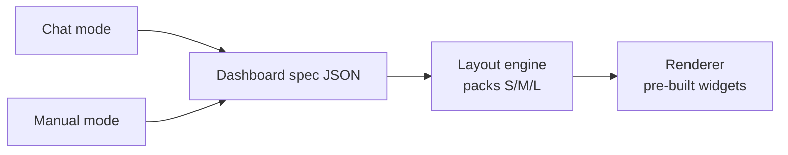
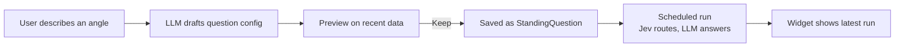

# IntelMonitor — UI/UX Spec v2

Sep 24, 2026

## Purpose

**Design goal: an analyst sees what changed, and why, in one glance — and reaches the evidence in one tap.**

This doc covers the UI and UX. The backend, ingestion and experiment live in the main spec, [IntelMonitor — MVP Spec v3](https://claude.ai/code/artifact/056eed6a-bc3d-4522-893f-6d7da8936794). The clickable mock is on the [dashboard canvas](https://claude.ai/artifact/WSE5jE7CiDhMrk7mvAPx4v).
The mock for the sidebar, profile menu and New dashboard popup is `mocks/new-dashboard.html` ([published](https://claude.ai/artifact/TXoe4Z9QKhtFGBzbEsHCaG)).
The POC build plan, which sets what is built first, is `poc-plan.md`.

The bar to beat is AlphaSense. Its dashboards work, but they feel dated, start from a blank grid, and show feeds the analyst must read themselves. IntelMonitor should feel as calm and obvious as an Apple app, and show answers instead of feeds.

## Design principles

1. **Answers, not feeds.** A widget says "Regulatory: Stable → Watch", not 20 headlines.
2. **Changes first.** Every page opens with what's new since the analyst last looked.
3. **Evidence one tap away.** Every claim links to its sources. No dead-end summaries.
4. **No blank canvas.** Creating a monitor builds a starter dashboard. Users edit from there.
5. **One search bar.** Search and ask live in the same box. No second box, no rows of filter buttons.
6. **Calm by default.** Neutral surfaces. Color only means status: new, watch, needs attention.
7. **Everything links.** Any topic, group or entity name opens its page or its graph view.
8. **Two ways to build, one result.** Chat and manual editing change the same dashboard. Users can switch any time.

## Users and key jobs

Primary user: a supervisory or policy analyst who follows a few topics, sectors and institutions every week.

| Job | What good looks like |
| --- | --- |
| Morning check | Opens a dashboard and knows in under a minute what changed and what needs attention |
| Check a development | Taps it, reads a short summary, opens the sources, adds a note |
| Set up monitoring | Types "Monitor OCBC" or describes a dashboard, and gets something useful straight away |
| Explore connections | Moves from an entity to its group, topics and dependencies without searching |
| Hand over | Marks items reviewed and leaves notes a colleague can pick up |

## Information architecture

| Place | What it is | How users get there |
| --- | --- | --- |
| Dashboards | A user's own mix of widgets across monitors | Sidebar, top section |
| Monitor pages | One page per topic, group or entity (events in P1) | Sidebar "Monitors", search, any linked name |
| Evidence drawer | Sources behind a finding or development | "See evidence" on any item |
| Graph view | Linked subjects around the current page | "Open graph view" in a page's Links section |
| New dashboard | Popup with Build and Generate tabs | "New dashboard", first row of the sidebar's Dashboards list |
| Profile menu | Settings, Data sources, Run history, Keyboard shortcuts | Profile button at the bottom of the sidebar |

**Sidebar:** Dashboards ("New dashboard" first, then the user's dashboards), then Monitors (Topics, Groups, Entities, with counts), then the profile button (avatar, name, role) pinned to the bottom. Nothing else.

**Profile menu:** opens upward from the profile button. Settings, Data sources, Run history, Keyboard shortcuts. Esc or a click outside closes it.

**Top bar:** 56 px tall, one row.
The search field flexes from the left: "Search or ask about a topic, group or entity" with ⌘K, 32 px, bordered.
Typing a name jumps to its page.
Typing a question gets an answer with citations (P1; the POC only jumps to pages).
To the right of the search field, 8 px apart: a run status chip and an alerts button, both 32 px with a 1 px border at the 6 px control radius.
The chip shows a static 6 px dot and "**Monitoring** · Last run 06:00" and opens a Runs popover: runs newest first, each with a status mark, when, how (scheduled or manual), duration, source count and result, then "Next scheduled run" and a Run now button.
While a run is in progress the chip reads "**Running now** · 22 sources" with a static half-filled mark, and the list shows a Running now row.
Words and static marks carry the run state: no spinner, pulse or halo.
The chip has a fixed minimum width, so switching states does not move the bell.
The alerts button is a bell with an unread count badge inside it and opens an Alerts popover listing Needs attention and Watch developments, with Mark all read.
Popovers are 400 px wide at the 10 px radius, with a 1 px border and the pop shadow.
One popover is open at a time; Esc or a click outside closes it.

**Moving between scopes:** every monitor page has a Links section. From OCBC, one tap goes up to Singapore banks or out to Banking regulation.

## Key screens

### Dashboard

Title, the subjects it covers, then a 4-column widget grid. The last run time lives in the top bar chip. The "Since your last review" widget sits top-left and is the largest thing on screen. **Edit** turns on edit mode; **Add widget** opens the gallery.

### Monitor page (topic, group or entity)

Same order on every scope, so users learn it once:

1. **What changed** since last review, with badges (New, Updated, Needs attention).
2. **Standing questions**, one row each: answer, state, change badge. Custom questions sit in the same list with a "Custom" label, followed by "Add a question".
3. **Links**: linked subjects by type, plus "Open graph view".
4. **Actions**: Mark reviewed, Add note.

Group pages add common issues and outliers. Topic pages add the stage track (signal → consultation → proposed → enacted → enforced) and upcoming dates.

### Evidence drawer

Slides in from the right; the page stays visible behind it. Shows the finding, each source (title, date, source type, highlighted passage), confidence, and notes. Keyboard: Esc closes.

### Graph view

Opens centred on the current page at 1 hop, expandable to 2. Node color = type. Filters: node type, link type, time window. Nodes with new developments are highlighted. Click a node to open its page. Never shows the whole graph by default.

### New dashboard

A popup covering about 80% of the screen, not a new page, at the 14 px sheet radius.
The 48 px header has the title, Build and Generate as a 28 px segmented control, and a 28 px ghost close button.
Esc or a click on the dimmed backdrop closes it.

- **Build** (default): the dashboard preview fills the popup in edit mode.
  "Add widget" opens the widget gallery sheet over it (see Manual editing).
  Adding a widget closes the sheet and places the widget in the next free slot, outlined.
  Users drag widgets to rearrange them and click the minus to remove them.
  The footer has a name field, prefilled from the subjects used, and "Create dashboard".
- **Generate** (marked with a small monochrome sparkle): a floating prompt box, centered with a heading and three example prompts.
  The prompt is a 720 px floating surface with a 1 px `--line-strong` ring and the pop shadow, at the 14 px sheet radius (not a pill), with a round 32 px accent send button.
  This is the one deliberate exception to the flat, docked inputs elsewhere: the prompt is the page's single call to action, so it floats.
  After the first prompt the box slides to the bottom and stays floating there with the same treatment, and the generated dashboard fills the space above it (see Chat mode).
  Under reduced motion it moves without animating.
  The footer has "Create dashboard", enabled once no change is waiting for Keep or Undo.

Both tabs produce the same dashboard spec, and the created dashboard appears in the sidebar and opens.

## Widget system

**Fixed sizes, not free resizing.** This keeps layouts tidy and makes chat-built dashboards reliable.

| Size | Grid footprint | Use for |
| --- | --- | --- |
| Small | 1 × 1 | One number or state |
| Medium | 2 × 1 | A short list or a track |
| Large | 2 × 2 | The main story, or a list users act on |

**Catalog (MVP: 7 widgets)**

| Widget | Sizes | Shows |
| --- | --- | --- |
| Since your last review | M, L | New developments and state changes |
| Standing question | S, M | One question's answer + change badge; built-in or custom |
| Monitor summary | M, L | All question answers for one subject |
| Developments | M, L | Consolidated events, with evidence links |
| Direction of travel | S, M | Rising / flat / falling, with a small line |
| Watchlist | M, L | Entities with status; add or remove in place |
| Upcoming | S, M | Deadlines and effective dates |

**No Links widget.** Links are navigation, not an answer, so they live only in the Links section of monitor pages and in the graph view.
A graph widget earns a place only if it answers a question. The candidate is an **exposure map (P1)**: only the tracked subjects with new developments this run, plus the dependencies they share, to show concentration risk. It needs `DEPENDS_ON` data the MVP only has in hand-curated form.

**Rules**

- Every widget fills with live data from monitors. No empty placeholders.
- Every widget is tappable and opens the matching page or evidence.
- One title style: sentence case, grey, top-left. No all-caps labels.
- Badges are the only color: New (blue), Watch (amber), Needs attention (red), Stable (green).
- Each widget is a pre-built component with a typed settings schema. The same schema drives the gallery, manual edits and chat mode.

## Manual editing (iPadOS pattern)

- **Edit mode:** "Edit" shows a minus badge on each widget and makes widgets draggable. "Done" saves. Long-press on a widget also enters edit mode. No wiggle: continuous animation costs GPU on high-refresh displays.
- **Reorder:** drag a widget; others reflow smoothly into place. Order is the only layout state: the grid packs Small, Medium and Large widgets from the top left with no gaps, so dragging changes position in the order. Keyboard: focus a widget and use the arrow keys.
- **Remove:** tap the minus. An "Undo" toast appears for a few seconds.
- **Add:** "Add widget" opens a gallery sheet, like the iPadOS widget gallery with subjects in place of apps. Left: topics, groups and entities with search and a count of new developments. Right: the widgets that fit the selected subject, each a live preview with the user's real data, a size picker and an Add button. The first two are tagged "Suggested". Adding closes the sheet and places the widget in the next free slot, outlined briefly.
- **Configure in place:** tap a widget in edit mode and it flips to its settings (subject, question, time window).
- **Inline edits outside edit mode:** watchlists add and remove entities with a search field and × buttons, right in the widget.
- **Smart stacks (P1):** stack several widgets in one slot and swipe between them.

## Chat mode (generative UI)

**The LLM edits a dashboard spec. It never writes UI code.**



**How it works**

- The dashboard is a JSON spec: a list of widgets, each with type, size, order and settings.
- The agent has four tools: `add_widget`, `update_widget`, `remove_widget`, `reorder`. Arguments are checked against each widget's schema.
- AG-UI carries the conversation, the tool calls and the shared dashboard state between agent and page. Manual edits flow back, so the agent always sees the current layout.
- **The LLM never picks grid positions.** It picks type, size and order. A plain layout engine places the widgets. This avoids broken or overlapping layouts.

**UX rules**

- The Generate tab starts with a centered prompt. On the first send, the input slides to the bottom (one transition, off under reduced motion) and the dashboard fills in above it, one widget at a time.
- Each change appears in the live preview as it happens, with the changed widget outlined.
- Every change comes with **Keep** and **Undo**. Nothing is saved until the user keeps it.
- The chat reply lists what changed in plain words ("Added Watchlist, medium").
- If a request doesn't fit the catalog, the agent suggests the closest widget, or offers a custom standing question (see Custom standing questions below). It never invents a new widget type.
- Generated widgets can be dragged and removed in the preview, the same as in Build.
- Users can leave chat mode at any point and continue by hand, and vice versa.

**POC stack:** bare AG-UI (`@ag-ui/core`, `@ag-ui/client`) with our own components, no CopilotKit. The agent runs on the Claude Agent SDK. For the MAS build: check the AG-UI packages are in the internal npm mirror, and which internal LLM powers the agent.

## Custom standing questions

**A custom standing question is a question the user writes, answered by the normal pipeline and shown in an existing widget. The LLM writes the question config, never widget code.**
The question itself is in the POC. The Analysis card and Trend chart displays below are P1.

Use it when no widget covers the angle a user wants. Example: "Track chipmaker price trends."



**How it works**

1. The user writes the question under "Add a question" on a monitor page, describes the angle in the Generate tab, or picks "Custom question" in the widget gallery.
2. The agent calls a fifth tool, `create_custom_widget`, with a question config.
3. The user sees a preview answer built from recent data, then **Keep** or **Undo**.
4. On Keep, the config is saved as a `StandingQuestion` (see the main spec) and the widget joins the dashboard.
5. Each run uses the normal pipeline: Jev routes relevant documents to the question, the LLM writes the answer with citations, the run is stored.
6. The widget reads the latest run: the answer, what changed since the last run, and evidence links.

Example config the LLM produces:

```json
{"question": "How are chipmaker prices trending, and why?",
 "subjects": ["Semiconductor companies"],
 "sources": ["News", "Disclosures"],
 "schedule": "daily",
 "lookback_days": 7,
 "display": "analysis_card"}
```

**Display types.** Custom questions reuse generic widgets, so no new UI is built per request:

| Display | Sizes | Shows |
| --- | --- | --- |
| Standing question (default) | S, M | One answer + change badge |
| Analysis card (new) | M, L | Longer answer, a "what changed" line, sources |
| Trend chart (new) | M, L | A metric over time, split by subject or tag |

**Visualisations: the LLM picks what to chart, code computes the numbers.** The config names a metric, filter, grouping and time bucket. The backend validates it, runs the query on the store and passes real numbers to the chart component. The LLM never types a number into a chart. No sandbox is needed: it is still JSON.

```json
{"question": "Which chipmakers are seeing more adverse news?",
 "display": "trend_chart",
 "metric": "development_count",
 "filter": {"adverse": true},
 "group_by": "entity",
 "bucket": "week",
 "window_days": 90}
```

**Where chart numbers come from**

| Source | Example charts | How to show |
| --- | --- | --- |
| Jev tags in the store (category, stage, jurisdiction, adverse, materiality) | Adverse items per bank per week; regulatory stage over time; developments by jurisdiction | Lines and bars. Available from MVP data, so start here |
| Structured data (price feed, MAS datasets) | Chipmaker price trend | Lines. Only once a source exists |
| Figures the LLM extracts from text ("TSMC raised prices 10%") | Timeline of reported data points | Dots with a source link on each, never a smooth line |

The Trend chart also delivers the multi-month trend charts listed as P1 in the main spec.

**json-render (later, optional).** AG-UI carries the spec; json-render is a catalog-constrained spec format and renderer that can ride on it. Consider it only if users want the LLM to compose layouts inside a widget (e.g. a headline number, a small chart and a short list in one Analysis card). If used, register our own Apple-styled components instead of its bundled shadcn set.

**Rules**

- The LLM only fills the config schema. It never writes code or invents a widget type.
- Every custom question points at existing subjects. If one is missing (e.g. no "chipmakers" group), the agent proposes it with members and topic links, and the user confirms.
- Numbers are computed by code, never typed by the LLM. They come from Jev tags in the store or from structured data. News and DMS alone support narrative answers ("prices rising, driven by X"), not price lines.
- Custom questions carry a "Custom" label and show their question, so users can tell them from curated questions.
- Users edit the question later by flipping the widget to its settings, like any other widget.
- Each custom question adds an LLM run. The POC caps custom questions at 10 per user and answers them on demand over the stored corpus. Scheduled answering depends on scheduled runs, which are P1.

## Visual design

Apple-inspired and tightened for a desktop analyst tool: calm surfaces, a clear type hierarchy, low depth, one accent.
The reference is `mocks/refine-a.html`.
Tokens live on `:root` in `web/app/globals.css`, and `DESIGN.md` describes the system in full.
Colors are OKLCH, tinted slightly toward blue (hue 260); nothing is pure white or pure black.

| Token | Value | Use |
| --- | --- | --- |
| `--canvas` | `oklch(0.972 0.004 260)` | Page background |
| `--surface` | `oklch(0.993 0.002 260)` | Widgets, panels, drawer, popup, popovers, inputs |
| `--rail` | `oklch(0.955 0.005 260)` | Sidebar, segmented track, neutral badges |
| `--hover` | `oklch(0.925 0.006 260)` | Hover fill on nav items, ghost and icon buttons, popover rows |
| `--line` | `oklch(0.93 0.005 260)` | Row dividers inside a surface |
| `--line-strong` | `oklch(0.885 0.007 260)` | Button, popover and overlay borders; section rules |
| `--line-field` | `oklch(0.80 0.01 260)` | Input and select borders |
| `--ink` | `oklch(0.23 0.012 260)` | Primary text |
| `--ink2` | `oklch(0.47 0.014 260)` | Labels, meta, counts |
| `--ink3` | `oklch(0.56 0.012 260)` | Icons, placeholders on `--surface` |
| `--accent` / `--accent-strong` | `oklch(0.52 0.17 258)` / `oklch(0.46 0.16 258)` | Primary button, links, focus ring, selection / primary hover |
| New | `--new` on `--new-bg` | Badge |
| Watch | `--watch` on `--watch-bg` | Badge |
| Needs attention | `--attn` on `--attn-bg` | Badge |
| Stable | `--stable` | State text, no fill |
| `--mark` | `oklch(0.94 0.07 95)` | Evidence highlight on the quoted span only |

Blue appears only on the one primary button per view, links, the focus ring, the selected state and New.
Topic, group, entity and provider colors exist only inside the graph canvas and its legend.

**Type:** system font (SF on Apple devices), five sizes and three weights (400, 500, 600; no 700).
12 px for meta, widget titles and badges; 13 px for body, rows and controls; 15 px for section headers, answers and popup, drawer and dialog titles; 22 px for the "Since your last review" hero line only; 28 px for the page title.
Row titles are 13 px 500 and wrap to two lines before they truncate.
Dates and counts use tabular figures and right-align in lists.
Sentence case everywhere.

**Shape and depth:** four radius steps.
4 px for badges, tags and key caps; 6 px for buttons, inputs, segmented controls, nav and menu items and the toast; 10 px for widgets, panels, popovers and menus; 14 px for the popup, sheets, dialogs and the Generate prompt.
The evidence drawer is square.
Circles are only for status dots, the avatar and the Generate send button; nothing else is a pill.
Widgets and panels sit on the canvas with one low shadow (0 1px 3px at 11%) and no border.
Overlays carry a 1 px `--line-strong` border: popovers, menus, the toast, the drawer and the Generate prompt use the pop shadow; the popup, sheets and dialogs use the modal shadow over a dimmed backdrop.
Status sits in a fixed 112 px column of small tinted badges, so row titles share one left edge.

**Controls:** 32 px by default, 28 px in widget headers, toolbars and popovers.
Secondary buttons have a 1 px `--line-strong` border on `--surface`; there is at most one primary button per view.
One focus ring everywhere: a 2 px accent outline, 2 px offset.
Every control has a 44 px hit area, even when it looks smaller.

**Spacing:** 4 px base, on the scale 4, 8, 12, 16, 24, 32, 48.
Rows are 34 px (8 px above and below 13 px text) with a hairline between them.
Widgets are inset 12 px, less than the 16 px grid gap, so each widget reads as one group.
Monitor sections are 32 px apart; the page title sits 24 px above the content; the page gutter is 32 px.

**Motion:** only in response to the user: reflow on reorder, sheet open, drawer slide, the Generate prompt moving down, a short crossfade into widget settings, and a short fade-in for a widget the user or agent just added.
No continuous animations (no wiggle, pulse, shimmer or spinners).
One exception: while Generate waits for the agent's first change, the canvas blurs under a "Generating your dashboard" card with three rising dots; the dots animate only transform and opacity, and everything stops when the first widget lands.
All motion is off under reduced-motion settings.

**Dark mode (P1):** same tokens, redefined; badges keep their meaning.

## Accessibility and quality floor

- Text contrast at least 4.5:1 (3:1 for text 24 px and up).
- Everything works by keyboard: visible focus ring, logical tab order, Esc closes sheets and drawers.
- Touch targets at least 44 px, including the minus badges.
- Status is never color alone: badges always carry words.
- Real buttons, links and labelled inputs; icon-only buttons have labels for screen readers.
- Respects reduced-motion settings.
- Works from 1280 px desktop down to tablet width. Phone is P1.

## How we beat AlphaSense

| Area | AlphaSense today | IntelMonitor |
| --- | --- | --- |
| Starting point | Blank grid; add widgets one by one | Starter dashboard from a monitor, a template, or a chat request |
| Widget content | Feeds: news, documents, saved searches | Answers: what changed, states, trends, with evidence |
| Search | Keyword box + company box + two rows of filters | One box for search and questions |
| Layout | Free grid, dense and boxy | Three fixed sizes, calm spacing, clear hierarchy |
| Editing | Manage mode, menus per widget | Drag to rearrange, live gallery previews, edit in place |
| Watchlists | Separate add flow inside the widget | Type-ahead add and × remove, right in the widget |
| Connections | None visible | Links section and graph view on every page |
| Building by chat | Not available | Describe a dashboard; Keep or Undo each change |

## UX success metrics

| Metric | Why |  |
| --- | --- | --- |
| Time to first useful dashboard | Tests "no blank canvas" |  |
| Time to answer "what changed?" on a dashboard | The core promise |  |
| Evidence click-through rate | Trust in summaries |  |
| Share of dashboards built by chat vs by hand | Is generative UI worth it? |  |
| Keep vs Undo rate on chat changes | Quality of chat edits |  |
| Graph view opens per session, and what users do next | Is the graph navigation or decoration? |  |
| Pilot feedback: "easier than AlphaSense?" | The bar we set |  |
| Custom questions still on dashboards after 2 weeks | Are custom questions useful or one-offs? |  |

## Open questions

- [ ] Do pilot analysts want dashboards per person, per team, or both?
- [ ] Which 2–3 starter templates matter most?
- [ ] Should the evidence drawer show full documents or only highlighted passages?
- [ ] Are the AG-UI packages (and, if used, json-render) approved for the internal npm mirror? (POC uses bare AG-UI, no CopilotKit.)
- [ ] Is tablet use real for analysts, or is desktop enough for the MVP?
- [x] How many custom questions per user, and does anyone review them before they run? POC: 10 per user, no review.
- [ ] Is there a structured price or market data source for trend charts, or are custom questions narrative-only? POC: narrative-only.
 